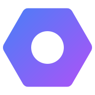

<div align="center">
  
  
  # Just Tools 🛠️
  
  Une collection d'outils de développement pratiques et créatifs pour simplifier votre workflow quotidien.
  
  [](https://github.com/pedrokarim/just-tools)
  [](https://nextjs.org/)
  [](https://www.typescriptlang.org/)
  [](https://tailwindcss.com/)
</div>

## 📚 Documentation

Toute la documentation du projet est disponible dans le dossier [`docs/`](./docs/) :

- **[Configuration Admin](./docs/ADMIN_SETUP.md)** - Setup du panel d'administration
- **[Migration Base de Données](./docs/DATABASE_MIGRATION.md)** - Guide SQLite → PostgreSQL
- **[Déploiement Docker](./docs/DOCKER_DEPLOYMENT.md)** - Configuration Docker
- **[SEO](./docs/SEO.md)** - Optimisations SEO
- **[Tests](./docs/TEST_README.md)** - Documentation des tests
- **[Synthèse Vocale](./docs/TEXT_TO_SPEECH.md)** - Paramètres d'URL, lecture automatique et client de raccourci clavier

## 🚀 Technologies Utilisées

- **Next.js 15** - Framework React moderne avec App Router et Turbopack
- **TypeScript** - Typage statique pour un code plus robuste
- **Tailwind CSS 4** - Framework CSS utilitaire de nouvelle génération
- **shadcn/ui** - Composants UI réutilisables et personnalisables
- **Framer Motion** - Animations fluides et transitions élégantes
- **Jotai & Zustand** - Gestion d'état moderne et performante
- **Lucide React** - Icônes modernes et cohérentes
- **Sonner** - Notifications toast élégantes
- **Next Themes** - Support du mode sombre/clair

## ✨ Fonctionnalités

### 🎨 Interface Moderne
- Design responsive et adaptatif
- Support du mode sombre/clair automatique
- Animations fluides avec Framer Motion
- Interface utilisateur intuitive et accessible
- Effets visuels avancés (particules, confettis, etc.)

### 🛠️ Outils Disponibles

#### ✅ Convertisseur Base64
- Encodez du texte en Base64
- Décodez du Base64 en texte
- Interface intuitive avec validation
- Copie en un clic
- Fonction d'échange entre entrée/sortie

#### ✅ Formateur de Code
- Formatage automatique de code dans différents langages
- Support de multiples langages de programmation
- Interface intuitive avec coloration syntaxique
- Options de formatage personnalisables

#### ✅ Générateur de Palette
- Création de palettes de couleurs harmonieuses
- Outils de génération automatique
- Export de palettes dans différents formats
- Interface intuitive pour la sélection de couleurs

#### ✅ Validateur JSON
- Validation et formatage JSON en temps réel
- Détection d'erreurs avec messages explicites
- Formatage automatique avec indentation
- Interface claire et intuitive

#### ✅ Générateur de Mots de Passe
- Génération de mots de passe sécurisés
- Options de personnalisation (longueur, caractères)
- Évaluation de la force du mot de passe
- Interface moderne et sécurisée

#### ✅ Éditeur Markdown
- Édition et prévisualisation Markdown en temps réel
- Support complet de la syntaxe Markdown
- Interface divisée (édition/prévisualisation)
- Export en différents formats

#### ✅ Éditeur de Motifs (Fullscreen)
- Création de motifs répétitifs avec une grille interactive
- Interface plein écran pour une expérience immersive
- Outils de dessin avancés
- Export de motifs personnalisés

#### ✅ Effet de Trame (Halftone)
- Ajout d'effets de trame halftone sur vos images
- Paramètres personnalisables (taille, densité, couleur)
- Interface intuitive avec prévisualisation
- Export d'images avec effets appliqués

#### ✅ Extracteur de Couleurs
- Extraction des couleurs dominantes de vos images
- Interface intuitive avec historique local
- Palette de couleurs harmonieuses
- Support du glisser-déposer d'images

#### ✅ Synthèse Vocale (Fullscreen)
- Conversion de texte en parole avec des voix naturelles
- Lecteur complet : barre de progression déplaçable, temps écoulé et durée
  estimée, pause qui interrompt réellement la voix, saut de ±10 s
- Suivi mot à mot pendant la lecture, clic dans le texte pour s'y déplacer
- Pilotable par URL (`?text=…&autoplay=1`) et mode lecteur épuré (`?mini=1`)
- Paramètres personnalisables (vitesse, hauteur, voix), multi-langues
- Import fichier, OCR d'images, traduction intégrée

Voir [`docs/TEXT_TO_SPEECH.md`](./docs/TEXT_TO_SPEECH.md) pour les paramètres
d'URL, et [`tts-hotkey/`](./tts-hotkey/) pour le client Windows qui envoie le
presse-papiers vers l'outil via un raccourci clavier global.

## 🏃‍♂️ Démarrage Rapide

### Prérequis
- [Node.js](https://nodejs.org/) (version 18 ou supérieure)
- [Bun](https://bun.sh/) (recommandé) ou npm/yarn

### Installation

1. **Cloner le projet**
   ```bash
   git clone https://github.com/pedrokarim/just-tools.git
   cd just-tools
   ```

2. **Installer les dépendances**
   ```bash
   # Avec Bun (recommandé)
   bun install
   
   # Ou avec npm
   npm install
   
   # Ou avec yarn
   yarn install
   ```

3. **Lancer le serveur de développement**
   ```bash
   # Avec Bun
   bun dev
   
   # Ou avec npm
   npm run dev
   
   # Ou avec yarn
   yarn dev
   ```

4. **Ouvrir votre navigateur**
   ```
   http://localhost:3000
   ```

## 📁 Structure du Projet

```
just-tools/
├── src/
│   ├── app/
│   │   ├── api/
│   │   │   ├── health/          # API de santé
│   │   │   └── proxy-image/     # API pour le proxy d'images
│   │   ├── tools/
│   │   │   ├── (scrollable)/    # Outils avec défilement
│   │   │   │   ├── base64-converter/
│   │   │   │   ├── color-extractor/
│   │   │   │   ├── color-palette/
│   │   │   │   ├── halftone/
│   │   │   │   ├── json-validator/
│   │   │   │   ├── markdown-editor/
│   │   │   │   ├── password-generator/
│   │   │   │   └── text-to-speech/
│   │   │   └── (fullscreen)/    # Outils plein écran
│   │   │       ├── code-formatter/
│   │   │       ├── json-validator/
│   │   │       └── pattern-editor/
│   │   ├── globals.css          # Styles globaux
│   │   ├── layout.tsx           # Layout racine
│   │   └── page.tsx             # Page d'accueil
│   ├── components/
│   │   ├── ui/                  # Composants shadcn/ui
│   │   ├── halftone/            # Composants spécifiques halftone
│   │   └── [animations]/        # Composants d'animation
│   └── lib/
│       ├── halftone-engine.ts   # Moteur halftone
│       ├── halftone-export.ts   # Export halftone
│       ├── halftone-store.ts    # Store halftone
│       ├── pattern-store.ts     # Store patterns
│       ├── tools-metadata.tsx   # Métadonnées des outils
│       └── utils.ts             # Utilitaires
├── public/                      # Assets statiques
└── package.json
```

## 🎯 Ajouter un Nouvel Outil

1. **Créer le dossier de l'outil**
   ```bash
   mkdir src/app/tools/(scrollable)/nom-de-loutil
   ```

2. **Créer la page de l'outil**
   ```tsx
   // src/app/tools/(scrollable)/nom-de-loutil/page.tsx
   "use client";
   
   export default function NomDeLOutil() {
     return (
       <div className="w-full space-y-6 p-6">
         <h1>Nom de l'outil</h1>
         {/* Votre interface ici */}
       </div>
     );
   }
   ```

3. **Ajouter les métadonnées de l'outil**
   - Modifier le fichier `src/lib/tools-metadata.tsx`
   - Ajouter une nouvelle entrée dans le tableau `toolsMetadata`
   - Inclure toutes les propriétés requises (id, name, description, etc.)

4. **Mettre à jour la liste des outils**
   - Modifier le tableau `tools` dans `src/lib/tools-data.tsx`
   - Changer le statut de `"coming-soon"` à `"ready"`

## 🎨 Personnalisation

### Thème
Le projet utilise Tailwind CSS 4 avec des variables CSS personnalisées. Modifiez `src/app/globals.css` pour changer les couleurs et le thème.

### Composants
Les composants shadcn/ui peuvent être personnalisés dans `src/components/ui/`.

### Animations
Le projet inclut de nombreux composants d'animation réutilisables dans `src/components/`.

## 📝 Scripts Disponibles

```bash
# Développement
bun dev          # Serveur de développement avec Turbopack
npm run dev      # Alternative avec npm

# Production
bun build        # Build de production
bun start        # Serveur de production

# Qualité du code
bun lint         # Vérification ESLint
npm run lint     # Alternative avec npm
```

## 🚀 Déploiement

Le projet est optimisé pour le déploiement sur Vercel :

1. Connectez votre repository à Vercel
2. Les paramètres de build sont automatiquement détectés
3. Déploiement automatique à chaque push

### Variables d'Environnement

Le projet utilise des variables d'environnement pour configurer les métadonnées et URLs :

```bash
# URL de base du site (utilisée pour les métadonnées Open Graph, etc.)
NEXT_PUBLIC_SITE_URL=https://just-tools.ascencia.re

# URL de fallback si la variable d'environnement n'est pas définie
NEXT_PUBLIC_FALLBACK_URL=https://just-tools.ascencia.re

# Nom du site
NEXT_PUBLIC_SITE_NAME=Just Tools

# Description du site
NEXT_PUBLIC_SITE_DESCRIPTION=Suite d'outils de développement gratuits
```

**Fallback automatique** : Si les variables d'environnement ne sont pas définies, le projet utilise automatiquement `https://just-tools.ascencia.re` comme URL de base.

## 🤝 Contribution

Les contributions sont les bienvenues ! N'hésitez pas à :

1. [Fork le projet](https://github.com/pedrokarim/just-tools/fork)
2. Créer une branche pour votre fonctionnalité (`git checkout -b feature/AmazingFeature`)
3. Commiter vos changements (`git commit -m 'Add some AmazingFeature'`)
4. Pousser vers la branche (`git push origin feature/AmazingFeature`)
5. [Ouvrir une Pull Request](https://github.com/pedrokarim/just-tools/compare)

### Guide de Contribution

- Respectez les conventions de code existantes
- Ajoutez des tests pour les nouvelles fonctionnalités
- Mettez à jour la documentation si nécessaire
- Utilisez des messages de commit descriptifs

## 📄 Licence

Ce projet est sous licence MIT. Voir le fichier `LICENSE` pour plus de détails.

## 🙏 Remerciements

- [shadcn/ui](https://ui.shadcn.com/) pour les composants UI
- [Tailwind CSS](https://tailwindcss.com/) pour le framework CSS
- [Lucide](https://lucide.dev/) pour les icônes
- [Next.js](https://nextjs.org/) pour le framework React
- [Framer Motion](https://www.framer.com/motion/) pour les animations
- [Vercel](https://vercel.com/) pour l'hébergement

## ✨ Nouvelles Fonctionnalités

### 🎯 Interface Améliorée
- **Headers dynamiques** : Chaque outil affiche son propre header avec icône, nom et description
- **Système de dates** : Gestion automatique des outils "nouveaux" basée sur les dates de création
- **Navigation optimisée** : Boutons d'action différenciés sur la page d'accueil
- **Espace maximal** : Tous les outils utilisent maintenant l'espace disponible au maximum

### 🛠️ Outils Récents
- **Synthèse Vocale** : Conversion texte-parole avec contrôles avancés
- **Extracteur de Couleurs** : Extraction de palettes depuis vos images
- **Headers harmonisés** : Interface cohérente sur tous les outils

## 📊 Statistiques

- **10 outils** disponibles et fonctionnels
- **Interface moderne** avec animations fluides
- **Support complet** du mode sombre/clair
- **Performance optimisée** avec Next.js 15 et Turbopack
- **Accessibilité** respectée sur tous les outils
- **Headers dynamiques** pour une expérience utilisateur améliorée

---

Développé avec ❤️ pour la communauté des développeurs

**⭐ N'oubliez pas de donner une étoile au projet si vous l'aimez !**
